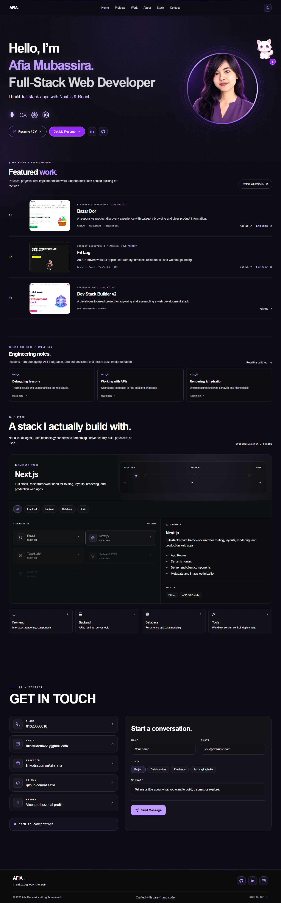

# Afia A. — Portfolio

<p align="center">
  <strong>BUILD. LEARN. REPEAT.</strong>
  <br />
  A personal portfolio showcasing my work, development journey, and approach to building for the web.
  <br /><br />
  <a href="https://afia-portfolio-drab.vercel.app/">Live Portfolio</a>
  &nbsp;·&nbsp;
  <a href="https://github.com/afiaafia">GitHub</a>
  &nbsp;·&nbsp;
  <a href="https://linkedin.com/in/afia-afia">LinkedIn</a>
</p>



---

## 01 — The Idea

This portfolio is my digital home as a full-stack web developer. It brings my projects, background, skills, and contact links together in one place.

Rather than treating a portfolio as a static list of projects, I designed it as a personal web experience—with a dark visual identity, violet accents, interactive details, and dedicated project pages.

**The goal:** make it easy to explore what I build, understand how I approach development, and connect with me professionally.

## 02 — Explore

| Destination | What you'll find |
|---|---|
| Home | Introduction, professional identity, and quick links |
| Work | Selected projects and their details |
| Resume | Online resume and PDF download |
| Contact | Ways to connect professionally |

[**→ Visit the live portfolio**](https://afia-portfolio-drab.vercel.app/)


## 03 — Tech Stack

### Frontend Development
<p align="left">
  
</p>

Building responsive, interactive, and type-safe web interfaces.

### UI & Styling
<p align="left">
  
</p>

Creating modern layouts and consistent user interfaces.

### Backend Development
<p align="left">
  
</p>

Developing server-side logic and RESTful APIs.

### Database & ORM
<p align="left">
  
</p>

Managing application data, database models, and queries.

### Tools & Deployment
<p align="left">
  
</p>

Version control, code collaboration, and deployment.

## 04 — What Makes It Mine

- **Personal visual identity** — dark surfaces, violet accents, and a consistent design language.
- **Project-focused presentation** — dedicated project pages to give selected work more context.
- **Resume access** — view the resume and download a PDF copy.
- **Responsive interface** — designed to work across different screen sizes.
- **Interactive details** — animations and a small cat mascot add personality to the experience.
- **Developer links** — direct access to my GitHub and LinkedIn profiles.

## 05 — Run It Locally

### Prerequisites

- Node.js
- pnpm

### Installation

```bash
git clone https://github.com/afiaafia/afia-portfolio.git
cd afia-portfolio
pnpm install
pnpm dev
```

Open [http://localhost:3000](http://localhost:3000) in your browser.

### Available scripts

```bash
pnpm dev      # Start the development server
pnpm build    # Create a production build
pnpm start    # Start the production server
pnpm lint     # Run ESLint
```

## 06 — Project Layout

```text
afia-portfolio/
├── public/                 # Static assets and resume PDF
├── src/
│   ├── app/                # Routes, layouts, and page entry points
│   └── components/         # Reusable interface components
├── package.json
├── pnpm-lock.yaml
└── README.md
```

This is a simplified overview; individual folders contain additional components and configuration files.

## 07 — Design Principles

**Clarity over clutter.** Keep the important information easy to find.

**Personality with purpose.** Use visual details to make the experience memorable without distracting from the work.

**Projects first.** Give visitors a clear path from the introduction to the code and live demos.

**Built to evolve.** Treat the portfolio as an ongoing project that can grow alongside my skills and experience.

## 08 — About the Developer

I'm Afia A., a CST diploma student and full-stack web developer focused on learning by building real projects.

I enjoy exploring how interfaces, application logic, APIs, and thoughtful design come together to create useful web experiences.

<p align="center">
  <a href="https://linkedin.com/in/afia-afia">Connect on LinkedIn</a>
  &nbsp;·&nbsp;
  <a href="https://github.com/afiaafia">Explore my GitHub</a>
</p>

---

<p align="center">
  <sub>Designed with intention. Built one iteration at a time.</sub>
</p>
